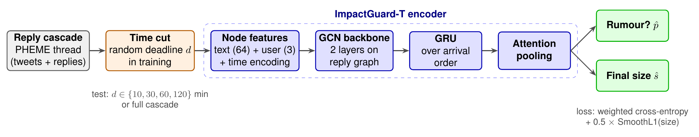
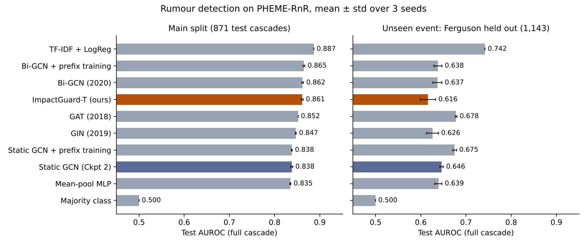
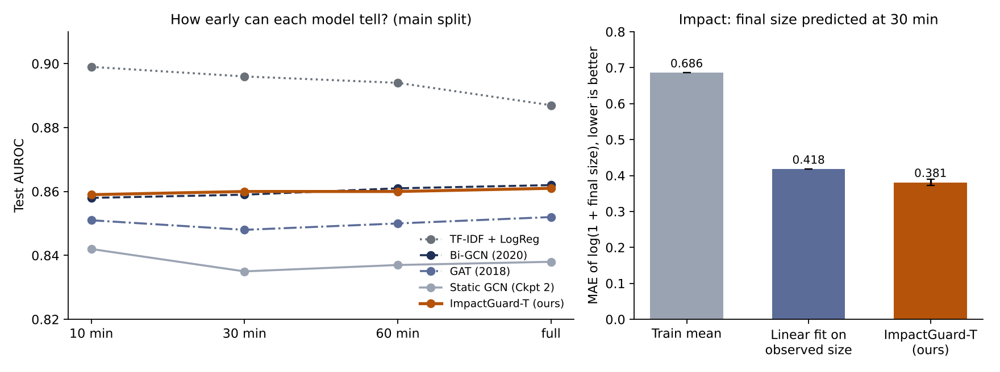
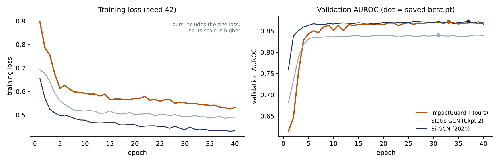
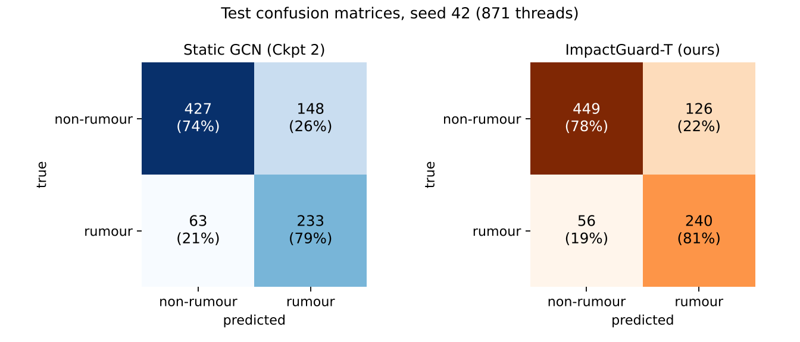
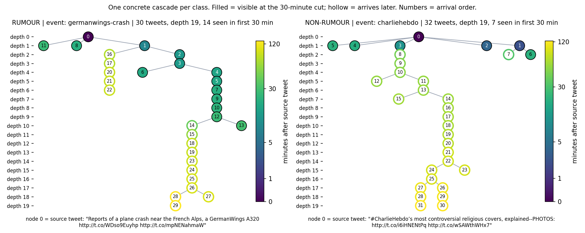

# ImpactGuard: Time-Aware Cascade Modelling for Early Rumour Detection and Impact Estimation

ImpactGuard looks at a Twitter reply thread while it is still growing and answers two questions: **is this a
rumour?** and **how big will this thread become?** Its core model, ImpactGuard-T, adds time to a graph neural
network, so it can decide after 10, 30 or 60 minutes instead of waiting for the thread to finish.

<ins>[Arshad Naguru](mailto:an2629@rit.edu)</ins> · M.S. in Artificial Intelligence, Rochester Institute of Technology · IDAI-780 Capstone, Fall 2026 · [GitHub](https://github.com/arshadnaguru)

<div align="center">

<p><i>Figure 1: ImpactGuard-T. A reply cascade is cut at a deadline d, encoded with text, user and time
features, passed through a GCN backbone on the reply graph and a GRU over arrival order, pooled with
attention, and sent to two heads: rumour probability and final cascade size (impact).</i></p>
</div>

## 📋 Table of Contents
- [ImpactGuard: Time-Aware Cascade Modelling for Early Rumour Detection and Impact Estimation](#impactguard-time-aware-cascade-modelling-for-early-rumour-detection-and-impact-estimation)
  - [📋 Table of Contents](#-table-of-contents)
  - [Installation](#installation)
    - [Clone the repository](#clone-the-repository)
    - [Create and activate conda environment](#create-and-activate-conda-environment)
    - [Install additional dependencies if any](#install-additional-dependencies-if-any)
  - [Project Structure](#project-structure)
  - [Data](#data)
  - [Usage](#usage)
    - [Training](#training)
    - [Evaluation](#evaluation)
  - [Demo](#demo)
  - [Results \& Visualization](#results--visualization)
  - [Method](#method)
  - [Baselines](#baselines)
  - [Model Card](#model-card)
  - [Citation](#citation)
  - [References](#references)
  - [Acknowledgements](#acknowledgements)
  - [License](#license)

## Installation

### Clone the repository
```bash
git clone https://github.com/arshadnaguru/ImpactGuard.git
cd ImpactGuard
```

### Create and activate conda environment
```bash
conda env create -f environment.yml
conda activate impactguard
```
Without conda: `python -m venv .venv && source .venv/bin/activate && pip install -r requirements.txt`
(on Windows, activate with `.venv\Scripts\activate`).

### Install additional dependencies if any
None. The only dependencies are PyTorch, scikit-learn, NumPy and Matplotlib, and every model is written in
plain PyTorch with no graph library. A GPU is optional: one full training run takes about 2 minutes on a
Colab GPU. On Google Colab, open [`notebooks/ImpactGuard_Colab.ipynb`](notebooks/ImpactGuard_Colab.ipynb)
and run the cells in order.

## Project Structure

```
ImpactGuard/
    ├── data/                     # Dataset storage and data files
    │   ├── README.md             #   data format and pre-processing steps
    │   └── samples/              #   pheme_samples.tar.gz: 100 REAL PHEME threads
    ├── scripts/                  # Standalone scripts and utilities
    │   ├── run_all.sh            #   every model, 3 seeds, then the comparison table
    │   ├── quick_demo.sh         #   2-minute end-to-end check on the samples (CPU is fine)
    │   └── make_readme_figures.py#   redraw figures/ from results/
    ├── models/                   # Trained model checkpoints (+ the featurizer each one needs)
    ├── notebooks/                # Jupyter notebook for Google Colab
    ├── results/                  # Experimental results and metrics
    │   ├── main_split.md         #   full comparison table, main split
    │   ├── event_split.md        #   full comparison table, unseen event
    │   └── logs/                 #   training logs (seed 42) and inference demo output
    ├── figures/                  # Project figures and visualizations (framework.tex = Figure 1 source)
    ├── src/                      # Source code (run every entry point from the repo root)
    │   ├── data/
    │   │   ├── download.py       #   download + unpack PHEME-RnR from figshare
    │   │   ├── pheme.py          #   load threads, rebuild reply trees, split, featurise, cut at a deadline
    │   │   ├── make_samples.py   #   build data/samples from the full corpus
    │   │   └── synthetic.py      #   tiny fake dataset for smoke tests only (never used for results)
    │   ├── models/
    │   │   ├── graph_batch.py    #   batch variable-size graphs, pooling helpers
    │   │   ├── baselines.py      #   MeanMLP, StaticGCN, GAT, GIN, Bi-GCN
    │   │   └── impactguard.py    #   ImpactGuard-T (core model)
    │   ├── utils/                #   metrics, validation threshold search, seeding
    │   ├── eval/                 #   per-deadline test metrics, cross-model comparison table
    │   ├── train.py              #   train + test one neural model, save logs and checkpoints
    │   ├── classic_baselines.py  #   majority class, TF-IDF + logistic regression, size baselines
    │   ├── evaluate.py           #   evaluate a saved checkpoint on its test split
    │   ├── predict.py            #   run a saved checkpoint on new threads
    │   ├── infer_demo.py         #   predictions over time for a batch of test threads
    │   └── visualize_thread.py   #   draw one real cascade per class
    ├── environment.yml
    ├── requirements.txt
    ├── _config.yml               # GitHub Pages theme
    ├── LICENSE
    └── README.md                 # Project documentation
```

## Data

PHEME-RnR [1]: 5,802 Twitter reply threads (1,972 rumour, 3,830 non-rumour; 102,351 tweets) from five
breaking-news events (Charlie Hebdo, Ferguson, Germanwings crash, Ottawa shooting, Sydney siege).

- **Sample, no download needed:** [`data/samples/pheme_samples.tar.gz`](data/samples/pheme_samples.tar.gz) holds 100 real threads
  (10 rumour and 10 non-rumour from each event) in the original folder format. Unpack it with
  `tar -xzf data/samples/pheme_samples.tar.gz -C data/samples` (the demo does this for you).
- **Full corpus, needed to reproduce the results:**
  ```bash
  python -m src.data.download            # 27 MB from figshare, unpacked into data/pheme
  ```

Cleaning and pre-processing run automatically inside [`src/data/pheme.py`](src/data/pheme.py):
1. read the raw JSON and skip broken files,
2. sort replies by time and keep at most 300 tweets per thread,
3. rebuild the reply tree and compute each tweet's arrival time,
4. build 67-d node features: 64-d TF-IDF→SVD text, fitted on the training split only, plus 3 user features.

Parsed threads are cached, so later runs start in seconds. Details: [`data/README.md`](data/README.md).

## Usage

### Training

```bash
python -m src.train --data data/pheme --model impactguard --seed 42
```
Other models: `--model mlp | gcn | gat | gin | bigcn`. Add `--prefix-aug` to train a baseline on time-cut threads too.

Default hyper-parameters, the same for every model: `--hidden 64`, dropout 0.3, Adam with `--lr 1e-3` and
weight decay 1e-4, `--bs 32`, `--epochs 40`, gradient clipping 2.0. Other options: `--split event --test-event ferguson`
holds out one event, and `--max-threads 800` trains on a subsample.

Each run writes to `runs/<model>_seed<k>/`:

| File | What it holds |
|---|---|
| `train.log` | full text log: per-epoch loss and validation metrics, then the test results |
| `train_log.csv` | the per-epoch numbers as a table |
| `best.pt` | checkpoint with the best validation score (plus the decision threshold) |
| `last.pt` | checkpoint after the last epoch |
| `featurizer.pkl` | the text featurizer fitted on this run's training threads |
| `metrics.json` | test metrics at every deadline |

To reproduce the full comparison (all baselines + ImpactGuard-T, 3 seeds each):
```bash
bash scripts/run_all.sh data/pheme runs                                             # main split
bash scripts/run_all.sh data/pheme runs_event --split event --test-event ferguson   # unseen event
```
The script skips runs that already finished, so you can restart it after an interruption.

### Evaluation

```bash
python -m src.evaluate --checkpoint models/impactguard_seed42.pt --data data/pheme
```
This re-creates the test split from the checkpoint and prints AUROC, F1 and accuracy after 10, 30, 60 and
120 minutes and on the full thread, the size error, and the confusion matrix. To build the comparison
table and chart from every run: `python -m src.eval.compare runs`.

## Demo

**1. Quick end-to-end check (about 2 minutes, CPU is fine):**
```bash
bash scripts/quick_demo.sh
```
It unpacks the sample, trains the GCN baseline and ImpactGuard-T for 5 epochs, prints the comparison and runs
inference. The numbers from 100 threads are not meaningful; this only shows the pipeline works.

**2. Inference on new data with the trained model (no training, no full download):**
```bash
python -m src.predict --checkpoint models/impactguard_seed42.pt --data data/samples/pheme_samples --deadline 30
```
For each thread it prints what the model saw in the first 30 minutes, the rumour probability, the
prediction and the predicted final size. Point `--data` at any folder in the PHEME layout to score your own
threads, or drop `--deadline` to use whole threads.

**3. Predictions over time for a batch of test threads:**
```bash
python -m src.infer_demo --ckpt runs/impactguard_seed42/best.pt --n 8
```
Example output: [`results/logs/infer_demo_output.txt`](results/logs/infer_demo_output.txt).

## Results & Visualization

All neural models: mean ± std over 3 training seeds, same data split, same features, same training budget.

**Main split (stratified 70/15/15, 871 test threads)**

| Method | AUROC | F1 (rumour) | Accuracy | AUROC first 10 min | AUROC first 30 min | Size MAE at 30 min ↓ |
|---|---|---|---|---|---|---|
| Majority class | 0.500 | 0.000 | 0.660 | 0.500 | 0.500 | 0.686 |
| TF-IDF + Logistic Regression | **0.887** | **0.726** | 0.781 | **0.899** | **0.896** | 0.418 |
| Mean-pool MLP | 0.835 ± 0.001 | 0.676 ± 0.007 | 0.754 ± 0.008 | 0.837 ± 0.001 | 0.833 ± 0.000 | – |
| Static GCN (our Ckpt 2 baseline) | 0.838 ± 0.002 | 0.684 ± 0.005 | 0.761 ± 0.011 | 0.842 ± 0.002 | 0.835 ± 0.001 | – |
| GAT (2018) | 0.852 ± 0.000 | 0.702 ± 0.007 | 0.768 ± 0.016 | 0.851 ± 0.001 | 0.848 ± 0.000 | – |
| GIN (2019) | 0.847 ± 0.001 | 0.711 ± 0.005 | 0.783 ± 0.004 | 0.851 ± 0.000 | 0.841 ± 0.001 | – |
| Bi-GCN (2020) | 0.862 ± 0.002 | 0.714 ± 0.007 | **0.801 ± 0.007** | 0.858 ± 0.003 | 0.859 ± 0.002 | – |
| *Ablation:* Bi-GCN + prefix training | 0.865 ± 0.002 | 0.715 ± 0.004 | 0.799 ± 0.007 | 0.864 ± 0.001 | 0.864 ± 0.001 | – |
| *Ablation:* Static GCN + prefix training | 0.838 ± 0.001 | 0.692 ± 0.007 | 0.769 ± 0.004 | 0.841 ± 0.002 | 0.837 ± 0.002 | – |
| **ImpactGuard-T (ours)** | 0.861 ± 0.002 | 0.711 ± 0.010 | 0.776 ± 0.011 | 0.859 ± 0.001 | 0.860 ± 0.003 | **0.381 ± 0.009** |

Size MAE is the mean absolute error of log(1 + final thread size). For the two classic rows it comes from a
train-mean predictor and from a linear fit on the number of tweets seen so far. Full table with the 60-minute
column: [`results/main_split.md`](results/main_split.md).

<div align="center"></div>
<div align="center"></div>

**What the results show**
- **Clear gain over our Ckpt 2 baseline.** ImpactGuard-T improves on the Static GCN by +0.022 AUROC, +0.027 F1
  and +0.025 AUROC at 30 minutes. The gap is about ten times the seed-to-seed standard deviation.
- **On par with the strongest graph model.** It is above GAT and GIN and within 0.002 AUROC of Bi-GCN.
- **Lowest impact error.** It is the only neural model that predicts final thread size, with MAE 0.381 against 0.418 for the best simple predictor.
- **Text is the bottleneck.** TF-IDF + logistic regression on 5,000 sparse word features is the best detector (0.887),
  while every graph model sees only a 64-d text summary. A stronger text encoder is the most promising next step.
- **Early signal.** Every model is almost as accurate after 10 minutes as on the full thread, so on PHEME most of the signal is in the source tweet and the first replies.

**Harder test: an unseen event (Ferguson held out, 1,143 test threads)**

| Method | AUROC | F1 | Accuracy |
|---|---|---|---|
| TF-IDF + Logistic Regression | **0.742** | **0.463** | **0.780** |
| GAT (2018) | 0.678 ± 0.002 | 0.311 ± 0.020 | 0.730 ± 0.001 |
| Static GCN + prefix training | 0.675 ± 0.004 | 0.382 ± 0.039 | 0.718 ± 0.005 |
| Static GCN (Ckpt 2) | 0.646 ± 0.004 | 0.330 ± 0.069 | 0.694 ± 0.035 |
| Bi-GCN (2020) | 0.637 ± 0.010 | 0.355 ± 0.050 | 0.715 ± 0.010 |
| GIN (2019) | 0.626 ± 0.013 | 0.376 ± 0.031 | 0.699 ± 0.014 |
| **ImpactGuard-T (ours)** | 0.616 ± 0.017 | 0.322 ± 0.019 | 0.733 ± 0.008 |

When a whole news event is unseen, every model drops sharply and ImpactGuard-T does not help. This is a known
limitation, recorded here on purpose. Full table: [`results/event_split.md`](results/event_split.md).

**Training curves and confusion matrices (seed 42)**
<div align="center"></div>
<div align="center"></div>

Raw logs: [`results/logs/`](results/logs/).

**One real cascade per class**
<div align="center">
<p><i>Nodes are tweets, edges are replies, colour is arrival time. Filled nodes are visible at the
30-minute cut; hollow nodes arrive later.</i></p></div>

## Method

A cascade is $C=(V,E,X,\boldsymbol{\tau})$: tweets $V$ in arrival order, reply edges $E$, node features
$x_i\in\mathbb{R}^{67}$ and arrival times $\tau_i$ in minutes after the source tweet. Its view at deadline
$d$ is the prefix $C_{\le d}=\{i:\tau_i\le d\}$. The model predicts $f_\theta(C_{\le d})=(\hat p,\hat s)$:
the rumour probability and the log final size $s=\log(1+|V|)$.

1. **Time encoding.** Each tweet gets $\cos(\omega t_i+b)$ with $t_i=\log(1+\tau_i)$, plus the log delay after its parent tweet and its log depth in the reply tree.
2. **GCN backbone.** Two graph convolution layers on the reply graph, $H^{(l+1)}=\mathrm{ReLU}(\hat A H^{(l)} W_l)$, with a residual connection.
3. **Temporal encoder.** A GRU [6] reads the tweets in arrival order.
4. **Attention pooling.** Attention over the GRU states, combined with the last state, a mean over nodes, and two cascade statistics (log size seen so far, log deadline).
5. **Two heads.** A classifier for rumour vs. non-rumour, and a regressor for the final size (impact).

**Training objective.** For every thread in a batch, a deadline $d$ is sampled from
$\{5,10,20,30,60,120,360,\infty\}$ minutes (prefix training):

$$\mathcal{L}(\theta)=\mathbb{E}_{(C,y)}\,\mathbb{E}_{d}\Big[-w_y\log\hat p_y(C_{\le d})+\lambda\,\mathrm{SmoothL1}\big(\hat s(C_{\le d}),\,s\big)\Big],\qquad\lambda=0.5,$$

with class weights $w_y$ to offset the class imbalance. The code is in [`src/models/impactguard.py`](src/models/impactguard.py) and the training loop in [`src/train.py`](src/train.py).

**Evaluation protocol.**
- Main split: 70/15/15 stratified by label, fixed by `--data-seed 42` for every model. The text features are fitted on training threads only, and the test set is used once.
- Model selection: the epoch with the best validation AUROC (mean of the full view and the 30-minute view) is saved; the decision threshold is chosen on validation.
- Metrics: AUROC (main), F1 on the rumour class, and accuracy. Early detection is AUROC with only the first 10/30/60/120 minutes visible. Impact is the MAE of log final size at 30 minutes.

## Baselines

| Baseline | File | Idea |
|---|---|---|
| Majority class | `src/classic_baselines.py` | always predicts non-rumour |
| TF-IDF + Logistic Regression | `src/classic_baselines.py` | bag of words over the tweets seen so far; no graph, no time |
| Mean-pool MLP | `src/models/baselines.py` | neural, averages tweet features; no graph |
| Static GCN | `src/models/baselines.py` | our Ckpt 2 baseline: GCN on the full reply graph, no time [2] |
| GAT | `src/models/baselines.py` | graph attention network [3] |
| GIN | `src/models/baselines.py` | graph isomorphism network [4] |
| Bi-GCN | `src/models/baselines.py` | rumour-specific: top-down and bottom-up GCNs with root feature enhancement [5] |
| + prefix training | `--prefix-aug` | ablation: a baseline trained on time-cut threads, to separate the training scheme from the architecture |

All baselines are my own re-implementations from their papers in plain PyTorch, trained with the same features, split, budget and model-selection rule as ImpactGuard-T.

## Model Card

| | |
|---|---|
| **Model** | ImpactGuard-T, 52,564 parameters, checkpoint [`models/impactguard_seed42.pt`](models/) |
| **Input** | a Twitter reply thread (source tweet + replies with timestamps and reply links), seen up to a deadline |
| **Output** | probability that the thread is a rumour; predicted final number of tweets |
| **Training data** | PHEME-RnR, 4,061 English threads from five news events in 2014–2015 |
| **Performance** | test AUROC 0.861 ± 0.002 on the main split; 0.616 ± 0.017 on an unseen event |
| **Intended use** | research and teaching on early rumour detection; a ranking signal to help human moderators decide what to check first |
| **Not intended for** | automatic removal of content or judging individual users without human review |
| **Limitations** | trained on five events only, so it transfers poorly to new events; English only; labels mark *rumour* (unverified at posting time), not *false*; a simple TF-IDF model is still stronger on detection |

## Citation

If you use this code, please cite:

```bibtex
@misc{naguru2026impactguard,
  title        = {ImpactGuard: Time-Aware Cascade Modelling for Early Rumour Detection and Impact Estimation},
  author       = {Naguru, Arshad},
  institution  = {Rochester Institute of Technology},
  howpublished = {\url{https://github.com/arshadnaguru/ImpactGuard}},
  note         = {IDAI-780 Capstone Project},
  year         = {2026}
}
```

Please also cite the PHEME dataset [1] and the baseline papers [2–5] you compare against.

## References

1. A. Zubiaga, M. Liakata, R. Procter. *Learning Reporting Dynamics during Breaking News for Rumour Detection in Social Media.* arXiv:1610.07363, 2016. Dataset: *PHEME dataset of rumours and non-rumours*, figshare, article 4010619.
2. T. N. Kipf, M. Welling. *Semi-Supervised Classification with Graph Convolutional Networks.* ICLR 2017.
3. P. Veličković, G. Cucurull, A. Casanova, A. Romero, P. Liò, Y. Bengio. *Graph Attention Networks.* ICLR 2018.
4. K. Xu, W. Hu, J. Leskovec, S. Jegelka. *How Powerful are Graph Neural Networks?* ICLR 2019.
5. T. Bian, X. Xiao, T. Xu, P. Zhao, W. Huang, Y. Rong, J. Huang. *Rumor Detection on Social Media with Bi-Directional Graph Convolutional Networks.* AAAI 2020.
6. K. Cho, B. van Merriënboer, C. Gulcehre, D. Bahdanau, F. Bougares, H. Schwenk, Y. Bengio. *Learning Phrase Representations using RNN Encoder–Decoder for Statistical Machine Translation.* EMNLP 2014.
7. S. M. Kazemi et al. *Time2Vec: Learning a Vector Representation of Time.* arXiv:1907.05321, 2019. (inspiration for the cosine time encoding)
8. A. Zubiaga, M. Liakata, R. Procter, G. Wong Sak Hoi, P. Tolmie. *Analysing How People Orient to and Spread Rumours in Social Media by Looking at Conversational Threads.* PLoS ONE 11(3), 2016.
9. A. Paszke et al. *PyTorch: An Imperative Style, High-Performance Deep Learning Library.* NeurIPS 2019. F. Pedregosa et al. *Scikit-learn: Machine Learning in Python.* JMLR 12, 2011.

## Acknowledgements

- Thanks to the authors of the PHEME dataset [1, 8] for releasing it publicly.
- The GCN, GAT, GIN and Bi-GCN baselines are my own re-implementations from the papers [2–5]; no code was copied from their repositories. Thanks to those authors for describing their methods clearly.
- Built with PyTorch and scikit-learn [9]; experiments were run on Google Colab.
- The repository layout follows the IDAI-780 cookiecutter template ([rtitung95/idai780_cookiecutter](https://github.com/rtitung95/idai780_cookiecutter)).
- Thanks to the IDAI-780 Capstone course at RIT for guidance and feedback on each checkpoint.

## License

This project is licensed under the MIT License - see the [LICENSE](LICENSE) file for details.
